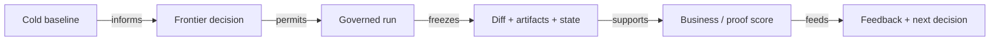
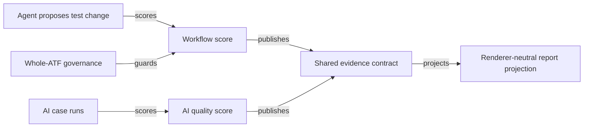
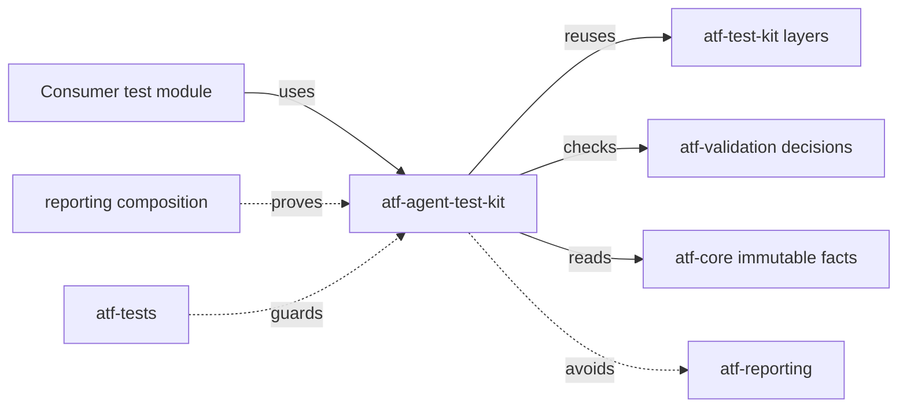

# ATF Java — cerințe chirurgicale pentru AI evaluation

## Overall

Acest document este feedback normativ pentru două capabilități distincte: workflow-ul
AI-assisted care propune schimbări și AI evaluation care evaluează output-ul observat.
Este destinat echipei ATF Java și stabilește contracte, dovezi și guard-uri de
guvernanță care trebuie validate înaintea implementării.

Acesta este documentul unic pentru cerințele AI și pentru feedback-ul comparativ
derivat din ATF1 și suita .NET de referință. Nu există un al doilea contract
normativ: secțiunile 34–42 păstrează auditul live, deciziile de adoptare,
limitele de copiere și ordinea de implementare.

- owner: ATF Java, cu validare în `atf-tests`;
- scope: evaluare AI, creare asistată de teste și handoff auditabil;
- out of scope: securitate, secrete, CLI și metodologia completă a ATF1;
- implementat: comparator field-level, missing/invented critical,
  invocation/evidence, grounding per field și snapshot-ul immutable `COMPLETE`;
- închis: package cohesion prin separarea semantică a responsabilităților;
- rămas: provider, run-level evidence ledger, reporting, review/state și workflow
  agentic.

Regula de integrare este chirurgicală: se preiau contracte observabile, ownership,
deduplicare, evidence și guard-uri; nu se copiază business-ul, scorurile,
orchestratorul runtime sau ceremonia de package/run din sursele de comparație.

## 1. Scop și limită

Acest document definește cerințele necesare pentru ca ATF Java să susțină
evaluarea AI la nivel auditabil, repetabil și extensibil.

Nu descrie un provider AI, un prompt framework sau un produs de business.
Definește contractele neutre prin care un consumer poate spune:

```text
acesta este cazul controlat
acesta este output-ul observat
acestea sunt așteptările verificabile
acesta este verdictul și motivul lui
aceasta este dovada care îl susține
```

Sunt excluse securitatea, secretele și CLI-ul.

Principiul de bază:

> ATF Java nu trebuie să devină proprietarul semanticii de business AI. Trebuie
> să devină proprietarul evaluării deterministe, evidence-ului, verdictului și
> proiecției auditabile.

## 2. Obiectiv de maturitate

Un caz AI este evaluat numai dacă următoarea succesiune este demonstrată de
date și teste:

```text
case versionat
  → input controlat
  → invocation observabilă
  → output normalizat
  → comparație field-level
  → verificare missing/grounding/review/state
  → score + hard-fail
  → snapshot semantic
  → evidence în raport
  → comparație cu baseline-ul anterior
```

Un `200 OK`, un text plauzibil sau un run verde nu sunt suficiente.

## 3. Reguli normative

### R-01 — Expected-ul este separat de output

Evaluatorul primește separat `expected case`, `observed output` și `evaluation
policy`. Expected-ul nu poate fi construit din output sau din raport.

**Invarianță:** modificarea output-ului nu modifică expected-ul.

**Gate:** component test care construiește expected-ul înainte de invocation și
verifică faptul că evaluatorul nu îl mută sau îl completează automat.

### R-02 — Fiecare verdict are cauză

Orice `PASS`, `FAIL`, `WARNING`, `SKIP` sau verdict AI special are:

- criteriul evaluat;
- valoarea expected;
- valoarea observed;
- regula de comparație;
- rezultatul regulii;
- evidence reference.

Verdictele fără cauză sunt diagnostice, nu dovezi.

### R-03 — Scorul nu ascunde hard-fail-ul

Un caz cu scor 98 poate fi `FAIL` dacă are un hard-fail. Score-ul este agregare;
hard-fail-ul este regulă de acceptare.

### R-04 — Fallback-ul nu este AI quality

Fallback-ul poate fi acceptat ca rezultat operațional dacă este declarat, dar nu
intră în scorul calității modelului.

### R-05 — Renderer-ul nu decide

Extent, fallback HTML și UI audit proiectează snapshot-ul semantic. Nu recalculează
score, hard-fail, grounding sau state.

### R-06 — Browser-ul verifică efectul, nu adevărul intern

Browserul verifică vizibilitatea și coerența verdictului, evidence-ului și
review-ului. Comparatorul rămâne în evaluator.

## 4. Contractul cazului AI

### 4.1 Identitate și versiune

```text
AiEvaluationCase
  caseId
  caseVersion
  category
  inputReference
  expectedIntent
  expectedFields
  expectedMissingFields
  expectedReview
  allowedStates
  groundingRequirements
  scoringPolicyId
```

`caseId` identifică scenariul semantic. `caseVersion` identifică așteptarea
aprobată. O schimbare de expected fără schimbarea versiunii este drift.

### 4.2 Input reference

Inputul este referit printr-un identificator de fixture controlat, nu prin path
local, nume de artifact sau timestamp.

Input reference trebuie să răspundă la:

- ce date au fost date modelului;
- ce date erau permise pentru grounding;
- ce date erau intenționat absente;
- ce versiune de fixture a fost folosită.

### 4.3 Expected intent

Intentul este enum sau vocabulary typed, nu text liber:

```text
CREATE | UPDATE | REVIEW_REQUIRED | REJECT |
REQUEST_MORE_INFORMATION | NO_ACTION
```

Evaluatorul distinge intent greșit, review greșit și state final greșit.

## 5. Contractul câmpurilor așteptate

### 5.1 Field expectation

```text
AiFieldExpectation
  fieldPath
  expectedValue
  comparisonMode
  required
  critical
  allowedValues
  sourceRequirement
  missingPolicy
```

`fieldPath` este semantic și stabil. Nu este selector CSS, index JSON accidental
sau label vizual.

### 5.2 Moduri obligatorii

| Mod | Regulă |
|---|---|
| `EXACT` | egalitate strictă după tip |
| `NORMALIZED_TEXT` | normalizare documentată, fără schimbare semantică |
| `SET` | aceleași valori, ordinea nu contează |
| `ORDERED_LIST` | aceleași valori și aceeași ordine |
| `RANGE` | valoarea este în limitele aprobate |
| `ALLOWED_VARIANTS` | numai variante declarate explicit |
| `PRESENT` | câmpul există și este nevid |
| `ABSENT` | câmpul lipsește sau este explicit necunoscut |
| `REGEX_RESTRICTED` | **amânat:** Java regex fără engine cu limită de execuție poate avea backtracking nebounded; nu se activează implicit |

Nu se acceptă `contains` generic drept comparație semantică.

### 5.3 Rezultatul comparației

```text
AiFieldComparison
  fieldPath
  expected
  observed
  comparisonMode
  normalizedExpected
  normalizedObserved
  result
  critical
  sourcePresence
  evidenceReference
  reasonCode
```

Reason codes stabile:

```text
MATCH | MISMATCH | MISSING_OBSERVED | UNEXPECTED_VALUE |
UNEXPECTED_PRESENT | NORMALIZATION_REJECTED | TYPE_MISMATCH |
SOURCE_UNSUPPORTED
```

Implementarea produce comparații immutable cu expected/observed, sursa declarată,
reason code și referința opacă la output. Mesajul de assertion nu este contract.

## 6. Missing information și non-invenție

Evaluatorul distinge:

1. câmp așteptat și prezent corect;
2. câmp așteptat, dar lipsă în output;
3. câmp intenționat absent și corect omis;
4. câmp absent în input, dar inventat în output;
5. câmp prezent în input, dar marcat incorect ca lipsă;
6. câmp necunoscut pentru care nu există expected obiectiv.

```text
AiMissingInformationResult
  fieldPath
  inputPresence
  expectedPresence
  observedPresence
  result
  critical
  reasonCode
```

Invenția unei entități critice produce `INVENTED_CRITICAL_ENTITY`, iar lipsa
unui câmp critic dintr-o sursă declarată prezentă produce
`MISSING_CRITICAL_FIELD`, indiferent de score. Dacă sursa este `UNKNOWN`, nu se
pretinde grounding și nu se numește automat valoarea „inventată”.

Aceste cazuri sunt acoperite prin probe component: output omis pentru source
present, output inventat pentru source absent, expected ABSENT în contradicție
cu source present și field suplimentar nedeclarat în output. Ultimul produce
`UNDECLARED_OUTPUT_FIELD` și hard-fail implicit; o politică explicită îl poate
tolera, dar comparația rămâne mismatch și reduce score-ul.

## 7. Grounding și source references

### 7.1 Contract

```text
AiSourceReference
  sourceId
  sourceType
  location
  excerptReference
  fieldPath
  supportStatus
```

`sourceType` poate fi `INPUT_FIELD`, `DOCUMENT_SPAN`, `EVENT`, `API_RESPONSE`
sau tip extins de consumer.

### 7.2 Reguli

- fiecare câmp cu `sourceRequirement` are reference;
- reference-ul indică o sursă permisă pentru caz;
- existența reference-ului nu dovedește singură suportul semantic;
- evaluatorul poate marca `UNSUPPORTED_SOURCE`;
- excerpt-ul nu se copiază în toate proiecțiile; se păstrează reference canonical
  și o proiecție bounded.

```text
AiGroundingObservation
  fieldPath
  sourceReference
  supportStatus
  result
  reasonCode
```

Rezultate minime: `SUPPORTED`, `UNSUPPORTED`, `AMBIGUOUS`, `NOT_REQUIRED`,
`MISSING_REFERENCE`.

**Slice implementat în `atf-validation`:** `AiGroundingRequirement` declară
allowlist-ul de `sourceId` pentru un field, `AiSourceReference` păstrează numai
pointeri opaci, iar evaluatorul produce `AiGroundingObservation` per field.
Un field cu grounding obligatoriu fără reference sau cu reference în afara
allowlist-ului produce hard-fail (`MISSING_GROUNDING_REFERENCE` /
`UNSUPPORTED_GROUNDING`). Payload-ul,
promptul și credentialele nu pot intra în aceste tipuri.

## 8. Review și workflow state

### 8.1 Review action

```text
AiReviewExpectation
  required
  action
  allowedActions
  expectedReasonCodes
  correctionRequired
```

Acțiuni: `ACCEPT`, `REJECT`, `REQUEST_MORE_INFORMATION`, `ESCALATE`,
`NO_REVIEW`.

### 8.2 State transition

```text
AiStateObservation
  previousState
  observedState
  allowedTransition
  transitionReason
  sequence
```

Un state final corect nu repară o tranziție intermediară invalidă.

### 8.3 Invariante

- review obligatoriu nu poate fi omis;
- `NO_REVIEW` este valid numai când cazul îl declară permis;
- user correction apare înaintea state-ului final care o reflectă;
- persistence failure este separat de model failure;
- retry-ul tehnic nu este o nouă decizie AI.

## 9. Invocation și fallback

### 9.1 Contract

```text
AiInvocationEvidence
  invocationId
  mode
  providerReference
  modelReference
  requestReference
  responseReference
  startedAt
  completedAt
  outputProduced
  references: INVOCATION | REQUEST | RESPONSE | OUTPUT
```

```text
InvocationMode
  REAL_AI | MOCK_MODEL | EXPLICIT_FALLBACK | UNKNOWN
```

| Mode | AI quality score | Interpretare |
|---|---:|---|
| `REAL_AI` | permis, cu evidence completă | evaluare AI propriu-zisă |
| `MOCK_MODEL` | interzis | test de integrare/comparator |
| `EXPLICIT_FALLBACK` | interzis | evidence operațională separată |
| `UNKNOWN` | interzis | hard-fail pentru test AI |

`AiInvocationEvidence` păstrează doar referințe opace, nu prompturi, payload-uri,
tokeni sau credentiale. `REAL_AI` primește quality score numai când are
invocation/provider/model, interval temporal, output și toate cele patru
referințe; `MOCK_MODEL` și `EXPLICIT_FALLBACK` rămân `NOT_EVALUATED` pentru
calitatea modelului.

Output valid fără invocation evidence se clasifică explicit:

```text
SILENT_FALLBACK | MISSING_INVOCATION_EVIDENCE | UNCLASSIFIED_OUTPUT
```

## 10. Scoring și hard-fail policy

### 10.1 Rubrică default

| Criteriu | Puncte |
|---|---:|
| Intent corect | 15 |
| Entități și câmpuri critice | 25 |
| Missing information / non-invenție | 15 |
| Routing și review | 15 |
| Grounding | 15 |
| Claritate explicație | 10 |
| Format / schema | 5 |
| **Total** | **100** |

Scoring policy este identificată prin `scoringPolicyId` și versionată.

### 10.2 Hard-fail catalog

| Code | Condiție |
|---|---|
| `INVENTED_CRITICAL_ENTITY` | entitate critică inventată |
| `MISSING_CRITICAL_FIELD` | câmp critic așteptat lipsește |
| `WRONG_INTENT` | intent incompatibil cu cazul |
| `REQUIRED_REVIEW_SKIPPED` | review obligatoriu nu apare |
| `INVALID_STATE_TRANSITION` | tranziție nepermisă |
| `UNSUPPORTED_GROUNDING` | valoarea nu are sursă permisă |
| `MISSING_INVOCATION_EVIDENCE` | testul pretinde AI real, dar nu dovedește invocation |
| `UNDECLARED_OUTPUT_FIELD` | output-ul conține un field care nu există în contractul case-ului |
| `INCOMPLETE_EVIDENCE` | verdictul nu poate fi reconstruit |

### 10.3 Verdict final

```text
AiEvaluationVerdict
  status
  score
  scoreBreakdown
  hardFailures
  fieldComparisons
  missingInformation
  groundingObservations
  reviewObservation
  stateObservations
  invocationEvidence
  evidenceReferences
```

Precedence:

```text
INCOMPLETE_EVIDENCE > HARD_FAIL > FAIL > TRIAGE_REQUIRED
> PASS_WITH_REVIEW > PASS
```

`SKIP` rămâne stare distinctă și nu intră în rata de succes.

## 11. Snapshot semantic și immutability

Evaluatorul produce un `AiEvaluationSnapshot` immutable după închiderea cazului.

```text
AiEvaluationSnapshot
  caseIdentity
  inputIdentity
  outputIdentity
  invocationIdentity
  verdict
  evidenceIndex
  traceMetadata
  completed
```

Invariante:

- snapshot-ul nu se modifică după `complete`;
- renderer-ul primește snapshot-ul, nu evaluatorul mutabil;
- proiecția HTML nu poate schimba verdictul;
- aceeași semantică produce aceeași proiecție în Extent și fallback;
- evidence references rămân stabile în run.

**Slice implementat în `atf-validation`:**

| Contract | Dovadă implementată |
|---|---|
| Lifecycle | doar snapshot `COMPLETE`, creat după comparații |
| Payload | case/version/input, policy, timestamp, verdict, eligibility, invocation, comparisons și hard-fails |
| Imutabilitate | copii defensive; fixed-clock și mutation tests |
| Rămâne deschis | evidence index/run correlation extins, trace metadata și lifecycle integration |

## 12. Integrarea cu lifecycle-ul ATF

```text
SETUP
  → case/input evidence
TEST BODY
  → invocation
  → observed output
  → AI validation
  → score/hard-fails
TEARDOWN
  → read-back/review persistence, dacă există
```

Într-un flow UI/API:

```text
un singur checkpoint semantic
  ├── UI validation
  ├── API validation
  └── AI validation
       ├── invocation evidence
       ├── field assertions
       ├── grounding
       └── score summary
```

Nu se creează un al doilea card pentru AI doar fiindcă output-ul este redat în
altă secțiune.

## 13. Raportare și proiecții

### Overview

Afișează agregat:

- cazuri evaluate;
- `PASS`, `FAIL`, `TRIAGE_REQUIRED`, `SKIP`;
- score mediu numai pentru cazurile eligibile;
- hard-fail count;
- fallback count;
- missing-evidence count;
- regression count.

### Test detail

Pentru fiecare caz sunt navigabile:

1. identity și versiune;
2. input reference;
3. invocation mode;
4. expected/observed summary;
5. tabel field-level;
6. missing information;
7. grounding;
8. review/state;
9. score breakdown;
10. hard-fail-uri;
11. evidence și trace.

### Fails și parity

Fiecare failure critic este individual și navigabil. Extent și fallback sunt
comparate prin snapshot semantic, nu prin string equality HTML.

## 14. Regression comparison

Identitatea baseline-ului este:

```text
caseId + caseVersion + inputReference + scoringPolicyId
```

Comparatorul produce:

```text
AiRegressionDelta
  scoreDelta
  newFailures
  fixedFailures
  newHardFailures
  changedFields
  changedMissingInformation
  changedGrounding
  changedReview
  changedState
  changedInvocationMode
```

Reguli:

- HTML-ul nu este baseline semantic;
- schimbarea ordinii tabelului nu este regresie business;
- schimbarea unui field critical este regresie chiar dacă score-ul total crește;
- `SKIP → PASS` nu este improvement fără evidence validă;
- `REAL_AI → FALLBACK` este regresie de invocation indiferent de output.

## 15. Arhitectură și ownership

| Contract | Owner | Interdicție |
|---|---|---|
| case și expected | consumer / composition root | nu intră în renderer |
| field comparator | `atf-validation` sau modul AI dedicat | nu intră în UI |
| score policy | evaluator semantic | nu se calculează în HTML |
| invocation adapter | integration boundary | nu se deduce din HTTP status |
| semantic snapshot | boundary renderer-neutral | nu conține markup |
| Extent/fallback projection | `atf-reporting` | nu schimbă verdictul |
| browser audit | `atf-ui` + consumer | nu decide calitatea modelului |
| layer/coverage guards | `atf-test-kit`, `atf-tests` | nu se relaxează pentru AI |
| production package cohesion | `atf-validation` + `atf-tests` | root-ul AI are 7 clase; `grounding`, `invocation` și `support` sunt subpachete semantice distincte, fiecare sub limita guvernată |

## 16. Teste obligatorii

### Unit

- toate comparison modes;
- normalizare deterministă;
- allowed variants;
- required/critical semantics;
- missing information;
- grounding reason codes;
- score calculation;
- hard-fail și verdict precedence;
- regression delta.

### Component

- case + expected + observed → snapshot;
- output inventat → hard-fail;
- review omis → hard-fail;
- source unsupported → grounding failure;
- unknown invocation → evidence failure;
- mock model → non-quality verdict;
- fallback explicit → evidence-only;
- snapshot immutable după complete.

### Integration

- provider/mock exchange + invocation evidence;
- correlation request/output/validation;
- phase/checkpoint attachment;
- Extent/fallback snapshot parity;
- regression baseline și delta;
- multi-field, multi-exchange case.

### E2E

Numai când există comportament vizibil:

- review UI afișează verdictul;
- câmpurile corectate sunt vizibile;
- state-ul final este observabil;
- AI validation este în checkpoint-ul corect;
- evidence disclosure-urile sunt navigabile;
- nu există duplicare UI/API/AI validation.

### Architecture

- evaluatorul nu importă rendererul;
- rendererul nu importă providerul AI;
- consumerul nu duplică scoring logic;
- fixture/support nu devine test implicit;
- fiecare public seam are proof class;
- snapshot-ul este renderer-neutral.

## 17. Failure taxonomy

| Categorie | Semnificație | Separare obligatorie |
|---|---|---|
| `EXTRACTION` | valoare greșită sau lipsă | nu este UI rendering |
| `CLASSIFICATION` | intent sau tip de caz greșit | nu este state transition |
| `ROUTING` | review/action greșit | nu este field mismatch |
| `WORKFLOW` | DAG/state/retry greșit | nu este output AI incorect |
| `REVIEW` | HITL lipsă sau corecție nepăstrată | nu este invocation failure |
| `GROUNDING` | sursă absentă/ambiguă/nesuportată | nu este schema failure |
| `INVOCATION` | AI/fallback necunoscut | nu este business mismatch |
| `EVIDENCE` | verdict nereconstructibil | nu este score mic |
| `SCHEMA` | output invalid ca formă | nu este valoare business greșită |
| `PERSISTENCE` | rezultat nepăstrat | nu este model quality |

Fiecare failure are owner probabil, dar ownerul nu se deduce din mesajul liber
al exception-ului.

## 18. Criterii de acceptare

Implementarea este acceptată numai când:

- un caz AI este definit fără logică în renderer;
- expected și observed sunt obiecte distincte;
- fiecare field comparison este typed și navigabil;
- missing information este evaluată separat de mismatch;
- grounding-ul poate fi `SUPPORTED`, `AMBIGUOUS` sau `MISSING_REFERENCE`;
- review și state sunt evaluate separat;
- invocation mode este explicit;
- fallback-ul nu intră în quality score;
- hard-fail-ul domină score-ul;
- snapshot-ul devine immutable la complete;
- Extent și fallback produc aceeași semantică;
- regression delta compară snapshot-uri, nu HTML brut;
- fiecare layer are test propriu;
- există caz nominal și negativ pentru fiecare regulă;
- un failure poate fi urmărit până la case, field, phase și evidence.

## 19. Roadmap de livrare

### Incrementul 1 — evaluator pur

Case model, field comparator, missing information, score și hard-fail.

**Status: implementat pentru modurile sigure enumerate mai jos.**

- Case-ul este versionat; expected-ul este construit separat de output.
- Evaluatorul suportă `EXACT`, `NORMALIZED_TEXT`, `SET`, `ORDERED_LIST`, `RANGE`,
  `ALLOWED_VARIANTS`, `PRESENT` și `ABSENT`.
- Source presence distinge omission, invenție critică și contradicție source/expected.
- Hard-fail-ul leagă field, expected, observed și referința la output.
- Output fields nedeclarate sunt hard-fail implicit; policy-ul poate permite
  explicit excepția, dar mismatch-ul și penalizarea rămân vizibile.

`REGEX_RESTRICTED` rămâne amânat până există un matcher cu execuție bounded.
Rubrica existentă este tehnică (weight + threshold), nu scor business AI
configurabil pe caz.

**Dovadă:** unit/component, fără browser și fără renderer.

### Incrementul 2 — snapshot și evidence

**Parțial implementat:** invocation evidence typed distinge real/mock/fallback/
unknown; referințele request/response/output sunt opace și mock/fallback nu
primesc quality score. Snapshot-ul evaluatorului este immutable și `COMPLETE`,
iar grounding-ul per field păstrează reference-uri opace și hard-fail-uri pentru
source lipsă/nesuportată. Lipsesc evidence ledger extins și integrarea cu
lifecycle-ul unui run/raport.

**Dovadă:** integration cu provider/mock și validation ledger.

### Incrementul 3 — raportare

AI validation în Tests/Overview/Fails/Evidence, cu parity Extent ↔ fallback.

**Dovadă:** contract tests și artifact static auditabil.

### Incrementul 4 — regression

Baseline identity și semantic delta: new/fixed failures, changed fields și
new hard-fails.

**Dovadă:** comparator între două snapshot-uri.

### Incrementul 5 — review UI

Review/state/read-back numai pentru efectele observabile.

**Dovadă:** component + integration + E2E focalizat.

## 20. Gap-uri active pentru evaluator

| ID | Cerință lipsă | Criteriu de închidere |
|---|---|---|
| `AI-EVAL-04` | grounding | **implementat per field:** allowlist de source IDs, `SUPPORTED`, `UNSUPPORTED`, `MISSING_REFERENCE` și hard-fail pentru field critic; `AMBIGUOUS` și run ledger rămân deschise |
| `AI-EVAL-05` | review/state | action și tranziții evaluate separat |
| `AI-EVAL-06` | invocation/fallback | **contract implementat:** real/mock/fallback/unknown; numai REAL_AI cu evidence completă poate produce score; lifecycle integration încă lipsește |
| `AI-EVAL-07` | hard-fail precedence | **probat pentru critical missing/invented/source contradiction și output nedeclarat:** `FAIL` domină score; catalogul AI complet și scenariile business încă lipsesc |
| `AI-EVAL-08` | semantic snapshot | **slice evaluator implementat:** snapshot immutable `COMPLETE`, policy/time, comparisons, grounding observations și invocation; evidence index extins, trace metadata și integrarea run lifecycle rămân deschise |
| `AI-EVAL-09` | reporting parity | Extent/fallback aceeași semantică |
| `AI-EVAL-10` | regression delta | comparație semantică între snapshot-uri |
| `AI-EVAL-11` | coverage governance | fiecare seam public are proof class |
| `AI-EVAL-12` | UI proof | review/state/evidence vizibile fără duplicare |

## 21. Analiză profundă — două axe care nu trebuie confundate

### 21.1 `AI-assisted workflow`

`AI-assisted workflow` răspunde la întrebarea:

> Cum poate un agent să propună, modifice și extindă teste ATF fără să strice
> contractele, layer-ele, ownership-ul sau evidence-ul?

Acesta nu măsoară calitatea modelului testat. Măsoară calitatea procesului prin
care agentul produce schimbări în framework și teste.

În forma actuală, ATF Java are deja protecții importante pentru agent:

- `atf-test-kit` impune layer-ul testului;
- `atf-tests` verifică modulele, ownership-ul, package cohesion și documentația;
- `atf-reporting-tests` are composition roots și proof lower-level;
- `atf-reporting` este separat de consumeri și de test support;
- README-urile și feedback-ul au owneri și criterii de închidere;
- artifactul poate fi auditat în browser, nu doar citit ca text.

Ce lipsește nu este încă un agent sau încă o bibliotecă de prompturi. Lipsește
un contract explicit pentru schimbarea propusă de agent:

```text
agent proposal
  → scope și owner
  → expected delta
  → test placement
  → proof plan
  → implementare
  → governance gates
  → narrow test evidence
  → feedback compilat pentru următorul agent
```

Fără această separare, un agent poate produce cod care compilează, dar:

- ajunge în modul greșit;
- duplică o abstraction existentă;
- adaugă E2E pentru o problemă component-level;
- mută business logic în reporting;
- pretinde coverage fără evidence;
- modifică un guard pentru a obține verde;
- lasă documentația în urmă față de cod;
- transformă un run verde într-o concluzie de calitate.

### 21.2 `AI evaluation propriu-zis`

`AI evaluation` răspunde la întrebarea:

> Este output-ul AI corect, complet, grounded, rutat și explicabil pentru cazul
> controlat?

Această axă folosește contractele din capitolele 4–18. Agentul care scrie testul
nu trebuie să fie judecătorul final al output-ului său. Evaluarea trebuie să fie
executată de reguli, comparatoare, fixtures și evidence independente de textul
agentului.

Separarea obligatorie este:

```text
agentul propune testul
ATF execută testul
evaluatorul compară expected cu observed
governance verifică forma schimbării
reporting-ul publică snapshot-ul
```

Un agent poate explica un failure, dar nu poate transforma singur un failure în
`PASS`, nu poate inventa expected-ul după output și nu poate relaxa un hard-fail.

### 21.3 Interacțiunea dintre axe

| Situație | Ce evaluăm | Ce nu deducem |
|---|---|---|
| Agentul generează un test bun | workflow-ul de creare | nu dovedește calitatea modelului AI testat |
| Testul AI trece | output-ul pentru cazul respectiv | nu dovedește că agentul a respectat arhitectura |
| Governance trece | placement, layer, proof și boundary | nu dovedește correctness business |
| Raportul este frumos | proiecția evidence-ului | nu dovedește un verdict corect |
| Modelul produce output plauzibil | comparația semantică | nu dovedește grounding sau invocation real |

Un scor de workflow și un scor de AI quality trebuie să rămână două valori
distincte în orice feedback viitor.

## 22. Ce extragem din ATF1 și ce nu importăm

ATF1 conține idei utile în documentele de pretraining, orchestration, execution
and understand, reporting și score overview. Nu trebuie importată metodologia
ca atare. Trebuie extrase doar principiile care întăresc contractele deja
existente în ATF Java.

| Idee ATF1 | Valoare transferabilă | Formă coerentă în ATF Java | Ce nu importăm |
|---|---|---|---|
| cold pretraining | agentul recitește sursa live înainte de schimbare | `baseline + owner + expected delta` în change contract | prompt library paralelă ca sursă de adevăr |
| anti-copy | benchmark-ul oferă formă, nu verdict sau business | governance verifică source-of-truth și drift | copiere de scoruri, business sau prose din exemple |
| orchestrator / execution / reporting | separarea deciziei, execuției și publicării | `atf-tests` verifică; modulele execută; reporting-ul proiectează | un orchestrator runtime nou în production |
| run-state și package-state | următorul agent are memorie rece | snapshot/checklist bounded, legat de evidence | zeci de fișiere obligatorii pentru orice test mic |
| expected delta | schimbarea trebuie să aducă ceva verificabil | delta card cu claim, owner, proof și rezultat | target artificial de număr de teste |
| frontier ranking | agentul alege următoarea zonă cu gap real | feedback priority + missing proof în owner docs | accounting de sloturi și proces de portofoliu |
| claim → proof → artifact | nicio afirmație fără dovadă | coverage/proof contract în `atf-tests` | raport separat care rejudecă runtime-ul |
| cold score cap | formă bună nu compensează lipsa substanței | hard cap pentru missing business/evidence proof | score wall decorativ sau scoruri paralele |
| feedback per run | următorul agent învață din failure-ul precedent | feedback compilat cu `lesson`, `owner`, `next proof` | jurnal narativ lung fără efect asupra deciziei |

Concluzia este că ATF trebuie să adopte disciplina de memorie, proof și
handoff, nu întreaga economie de runs, slots, prompts și state files din ATF1.

## 23. Model ATF-native pentru agentic test creation

### 23.1 Contractul schimbării propuse de agent

Înainte de implementare, orice schimbare agentic relevantă trebuie să poată fi
reprezentată printr-un contract bounded:

```text
AtfAgentChangeProposal
  proposalId
  targetOwner
  targetBoundary
  sourceBaseline
  problemStatement
  expectedDelta
  affectedModules
  proposedLayer
  proofPlan
  negativeCasePlan
  documentationImpact
  knownLimits
```

Semantica este strictă:

- `targetOwner` spune cine trebuie să dețină schimbarea;
- `targetBoundary` spune ce seam se schimbă;
- `sourceBaseline` indică codul/testul/documentul recitit;
- `expectedDelta` descrie noutatea, nu volumul de cod;
- `proposedLayer` este layer-ul minim care poate demonstra schimbarea;
- `proofPlan` enumeră testul și artifactul necesar;
- `negativeCasePlan` previne testul happy-path fără contract failure;
- `documentationImpact` spune ce README/feedback se schimbă;
- `knownLimits` împiedică agentul să vândă o dovadă parțială ca soluție completă.

### 23.2 Contractul de handoff

După implementare, agentul trebuie să poată lăsa următoarea informație
reconstructibilă:

```text
AtfAgentChangeHandoff
  proposalId
  changedSources
  testsAddedOrChanged
  gatesExecuted
  evidenceProduced
  verdict
  unresolvedGaps
  nextProof
```

Handoff-ul nu este un rezumat de conversație. Este o referință rece între
source diff, test, gate și artifact.

### 23.3 Fluxul propus

```mermaid
flowchart LR
    Agent[Agent proposal] -->|compară| Baseline[Live baseline]
    Baseline -->|definește| Contract[Change contract]
    Contract -->|verifică| Owner[Owner/layer check]
    Owner -->|limitează| Implement[Scoped implementation]
    Implement -->|dovedește| Unit[Focused tests]
    Unit -->|alimentează| Governance[Whole-ATF governance]
    Governance -->|produce| Artifact[Evidence/artifact]
    Artifact -->|compilează| Handoff[Compiled feedback]
    Handoff -->|decide| Next[Next agent decision]
```



<details>
<summary><strong>Legendă — fluxul propus și limita evaluării</strong></summary>

- `Agent proposal` este schimbarea propusă, nu dovada că schimbarea este corectă.
- `Whole-ATF governance` validează contractul, layer-ul, testele și documentația.
- `AI evaluation` măsoară calitatea output-ului și rămâne separat de scorul workflow-ului.
</details>

Regula de oprire: dacă baseline-ul, ownerul sau proof plan-ul nu sunt clare,
agentul nu începe o refactorizare largă. Produce gap diagnostic și cere un
contract mai îngust.

## 24. Direcția recomandată pentru `atf-tests`

Da, `atf-tests` este locul potrivit pentru guvernanță transversală, dar nu pentru
generarea de teste de produs și nu pentru logică de agent.

`atf-tests` ar trebui să verifice proprietăți ale schimbării agentic, nu să
înțeleagă business-ul fiecărui consumer.

### 24.1 Guard-uri propuse — doar design, nu implementare

| Guard propus | Ce verifică | Failure util pentru agent |
|---|---|---|
| `AgentChangeOwnerGovernanceTest` | schimbarea este în modul/package owner corect | „mută testul în consumerul care deține flow-ul” |
| `AgentTestLayerGovernanceTest` | layer-ul declarat corespunde boundary-ului | „component proof este suficient; nu adăuga E2E” |
| `AgentProofPlanGovernanceTest` | fiecare public seam nou are test/proof identificabil | „claim fără proof class” |
| `AgentNegativeCaseGovernanceTest` | schimbarea de contract are failure-path | „lipsește dovada pentru invalid/missing state” |
| `AgentDuplicateAbstractionGovernanceTest` | nu există service/validator/adapter duplicat | „reutilizează ownerul existent” |
| `AgentBoundaryDependencyGovernanceTest` | nu apar importuri inverse sau renderer/business leakage | „schimbarea a traversat boundary-ul interzis” |
| `AgentDocumentationDriftGovernanceTest` | README/feedback rămâne coerent cu source și tests | „actualizează owner doc sau marchează limita” |
| `AgentEvidenceBindingGovernanceTest` | testul produce evidence legată de checkpoint/request | „verdictul nu este reconstructibil” |
| `AgentNoLiteralVerdictGovernanceTest` | assertions nu folosesc `true`/`false` fără observed fact | „înlocuiește verdictul constant cu observație reală” |
| `AgentFixtureIsolationGovernanceTest` | fixture-ul nu depinde de state global implicit | „separă contextul per test” |
| `AgentChangeHandoffGovernanceTest` | schimbarea lasă delta, gates, verdict și gap-uri | „handoff incomplet pentru următorul agent” |

### 24.2 Ce trebuie să producă un guard

Fiecare guard trebuie să emită diagnostic structurat:

```text
ruleId
severity
file
line
owner
observedFact
expectedContract
minimalRemediation
proofRequired
```

Mesajul trebuie să fie suficient pentru ca agentul să poată face o corecție
locală fără să ghicească intenția. Guard-ul nu trebuie să genereze patch-uri
automat și nu trebuie să ascundă excepții prin allowlist generic.

### 24.3 Ordinea guard-urilor

Ordinea este importantă; altfel agentul repară simptomele în ordinea greșită:

```text
1. source/baseline readable
2. owner și boundary
3. layer minim
4. dependency direction
5. assertion/evidence trust
6. negative case
7. documentation drift
8. artifact/handoff completeness
```

Un failure de owner trebuie raportat înaintea unui failure de formatting al
raportului. Un failure de evidence trebuie raportat înaintea scorului de
business.

## 25. Pretraining ATF redus la esențial

Nu recomandăm un pretraining separat, cu prompturi și artefacte numeroase.
Recomandăm un `cold baseline read` bounded, executat înaintea unei schimbări
agentic semnificative.

### 25.1 Input minim

Agentul recitește numai:

1. README-ul ownerului;
2. POM-ul și modulele afectate;
3. testele relevante;
4. feedback-ul activ al ownerului;
5. gate-ul care poate valida schimbarea;
6. ultimul artifact sau snapshot relevant, dacă schimbarea este vizuală/
   semantică.

### 25.2 Output minim

Produce un card scurt:

```text
baseline found = yes/no
owner = ...
boundary = ...
existing seam = ...
new gap = ...
minimum layer = ...
proof class = ...
negative case = ...
documentation impact = ...
```

Nu este permis ca agentul să preia scor, verdict sau business dintr-un benchmark
fără să verifice codul și testele locale.

### 25.3 Când baseline-ul este insuficient

Agentul trebuie să se oprească diagnostic dacă:

- source și README se contrazic;
- testul citat nu există;
- artifactul este stale și nu poate fi legat de source;
- ownerul boundary-ului este ambiguu;
- expected-ul business nu este obiectiv;
- schimbarea ar cere simultan mai mult de un owner major.

Acesta este un `BLOCKED_FOR_BASELINE`, nu un failure de implementare și nu un
motiv pentru a inventa o arhitectură paralelă.

## 26. AI evaluation propriu-zis în acest workflow

### 26.1 Roluri distincte

| Rol | Responsabilitate | Nu are voie |
|---|---|---|
| agent author | propune test, fixture și proof plan | să decidă singur verdictul AI |
| test runtime | execută schimbul și capturează facts | să completeze expected-ul |
| AI evaluator | compară expected/observed și calculează score | să citească markup pentru verdict |
| governance | verifică layer, owner, boundary și trust | să judece valoarea business a output-ului |
| reporting | publică snapshot-ul | să recalculeze score-ul |
| reviewer | decide dacă limita rămasă este acceptabilă | să transforme lipsa evidence în pass |

### 26.2 Testul generat de agent trebuie să conțină facts observabile

Pentru un test AI, assertion-ul trebuie să fie construit din facts:

```text
observed intent
observed field value
observed source reference
observed review action
observed workflow state
observed invocation mode
```

Nu este acceptabil:

```java
assertTrue("AI result looks correct");
```

Este necesar un assertion semantic care poate alimenta `AiFieldComparison`,
`AiGroundingObservation`, `AiReviewObservation` sau `AiStateObservation`.

### 26.3 Testul generat nu trebuie să fie evaluatorul

Agentul poate genera fixture-ul și wiring-ul, dar score policy trebuie să fie
reutilizată din evaluator. Dacă fiecare test își scrie propriul calcul de scor,
rezultatele nu mai sunt comparabile și governance-ul nu mai poate identifica
drift-ul.

### 26.4 Quality score și workflow score

Trebuie păstrate separat:

```text
AI quality score
  = correctness, completeness, grounding, review, state

agent workflow score
  = owner, layer, proof, evidence, documentation, handoff
```

Un agent poate avea workflow score 100 și să producă un test care demonstrează
că modelul are quality score 42. Aceasta este o execuție bună a unui test care a
găsit o problemă reală.

Invers, un test poate afișa AI quality 96, dar să aibă workflow score scăzut
dacă expected-ul a fost inventat, invocation-ul nu este dovedit sau assertion-ul
este literal.

## 27. Feedback compilat pentru următorul agent

Feedback-ul trebuie să fie scurt în suprafața de consum, dar suficient de precis
pentru reparare:

```text
AtfAgentFeedback
  proposalId
  status: ACCEPTED | PARTIAL | REPAIR_REQUIRED | BLOCKED_FOR_BASELINE
  strongestProof
  decisiveFailure
  violatedRuleId
  affectedOwner
  observedFact
  whyItMatters
  minimalNextChange
  nextProofClass
  notToDo
```

### 27.1 Exemplu constructiv

```text
status = REPAIR_REQUIRED
violatedRuleId = AgentEvidenceBindingGovernanceTest
observedFact = test asserts HTTP 200 but does not publish response field evidence
whyItMatters = a green test cannot reconstruct the business verdict
minimalNextChange = bind response snapshot to the existing API checkpoint
nextProofClass = component + report contract
notToDo = do not add a second E2E journey
```

### 27.2 Ordinea feedback-ului

Feedback-ul compilat trebuie să răspundă în această ordine:

1. ce este demonstrat;
2. ce este încă nedemonstrat;
3. care regulă a fost încălcată;
4. ce owner repară;
5. care este schimbarea minimă;
6. care este dovada următoare;
7. ce soluție aparentă trebuie evitată.

Această ordine reduce tendința agentului de a face refactorizare largă după un
failure local.

## 28. Feedback constructiv asupra direcției ATF Java

### Punct forte de păstrat

ATF Java are deja un boundary foarte bun între test contract, runtime, verdict,
reporting și browser audit. Nu trebuie înlocuit cu un agent runtime sau cu un
framework de prompturi în production.

### Gap principal

Guvernanța actuală protejează bine codul deja existent, dar nu exprimă încă
contractul unei schimbări propuse de un agent: de ce se schimbă, unde aparține,
care este delta, care este dovada minimă și ce limită rămâne.

### Gap secundar

AI evaluation este definită conceptual prin case, expected, observed, score și
evidence, dar nu este încă conectată la un workflow de generare a testelor care
poate produce automat un failure explicabil pentru agent.

### Riscul cel mai mare

Adăugarea directă a unei “AI layer” în `atf-reporting` sau `atf-core` ar amesteca
business semantics, provider details și rendering. Aceasta ar crește aparent
capability-ul, dar ar scădea reutilizabilitatea și ar face score-ul greu de
reconstruit.

### Direcția recomandată

1. păstrează evaluatorul și case model renderer-neutral;
2. pune consumer-specific expected în composition root;
3. folosește `atf-tests` pentru guard-uri whole-repository;
4. folosește `atf-test-kit` numai pentru vocabular și layer contract;
5. folosește `atf-reporting-tests` pentru composition și proof;
6. păstrează feedback-ul activ ca registry al gap-urilor, nu ca duplicat al
   README-urilor;
7. implementează întâi contractul și gate-urile, apoi orice orchestrare agentic.

## 29. Decizie înainte de implementare

Nu se implementează încă nimic până când nu sunt aprobate următoarele decizii:

| Decizie | Întrebare care trebuie închisă |
|---|---|
| contract | `AtfAgentChangeProposal` este suficient sau trebuie redus? |
| artifact | ce parte este machine-readable și ce parte rămâne Markdown? |
| owner | `atf-tests` verifică propunerea sau doar rezultatul schimbării? |
| layer | `atf-test-kit` primește vocabulary pentru agent sau rămâne strict layer-only? |
| score | workflow score este diagnostic sau gate? |
| evidence | care facts sunt obligatorii pentru un test AI generat? |
| baseline | ce înseamnă stale artifact și cum este detectat? |
| handoff | care este minimul necesar pentru următorul agent? |
| scope | ce guard-uri sunt generic whole-ATF și ce rămâne consumer-specific? |

Regula recomandată: prima implementare trebuie să fie un set mic de guard-uri
de governance și un feedback contract, nu un agent complet.

## 30. Plan de validare propus, fără implementare încă

### Etapa A — contract review

Se validează vocabulary-ul, ownerii, severity și câmpurile obligatorii ale
proposal/handoff/feedback. Niciun test nou de produs.

### Etapa B — governance proof

Se proiectează câteva fixture-uri artificiale care demonstrează că guard-urile
detectează owner greșit, layer prea larg, literal verdict, evidence lipsă și
documentation drift.

### Etapa C — un singur test agentic pilot

Se alege un seam mic din `atf-reporting-tests`, nu un flow business mare.
Pilotul trebuie să producă proposal, diff, focused test, gate result și feedback.

### Etapa D — AI evaluation pilot

Se folosește un caz controlat cu expected/observed simplu, un failure critic și
un caz de fallback. Se validează că quality score rămâne separat de workflow
score.

### Etapa E — decizie de extindere

Doar dacă pilotul produce feedback reparabil și evidence reconstructibil se
extind guard-urile către restul reactorului.

## 31. Limite noi rezultate din această analiză

| ID | Gap | Prioritate | Dovadă necesară |
|---|---|---:|---|
| `AI-WORKFLOW-01` | nu există change proposal bounded pentru agent | P1 | proposal valid/invalid și diagnostics |
| `AI-WORKFLOW-02` | handoff-ul nu este machine-readable | P1 | handoff complet cu diff/gates/evidence |
| `AI-WORKFLOW-03` | nu există guard pentru owner/layer/proof plan | P1 | governance tests fail-closed |
| `AI-WORKFLOW-04` | agentul nu are feedback compilat standard | P1 | feedback cu rule, fact, fix și next proof |
| `AI-WORKFLOW-05` | documentația nu are încă agent-delta contract | P2 | documentation drift proof |
| `AI-WORKFLOW-06` | nu există separare explicită workflow score vs AI quality | P1 | două snapshot-uri/verdicturi distincte |
| `AI-WORKFLOW-07` | pretraining-ul este doar disciplină, nu contract | P2 | cold baseline card bounded |
| `AI-EVAL-13` | test generated nu este verificat pentru observed facts | P1 | literal verdict guard + evidence binding |
| `AI-EVAL-15` | feedback-ul de regression nu este handoff pentru agent | P2 | semantic delta → next proof |

Aceste item-uri sunt feedback de design. Nu reprezintă încă autorizație pentru
implementarea claselor sau schimbarea modulelor.

## 32. Surse analizate pentru această extindere

ATF Java:

- [`atf-tests/README.md`](../../atf-tests/README.md)
- [`atf-test-kit/README.md`](../../atf-test-kit/README.md)
- [`ATF_Architecture.md`](../ATF_Architecture.md)
- [`ATF_Evidence_Capture_Contract.md`](../ATF_Evidence_Capture_Contract.md)
- [`ATF_Reporting_Contract.md`](../ATF_Reporting_Contract.md)

ATF1, folosit numai ca sursă de idei:

```text
${ATF1_ROOT}/test-framework/docs/prompts/md-en/pretraining-reference.md
${ATF1_ROOT}/test-framework/docs/prompts/md-en/orchestrate-iterative-runs.md
${ATF1_ROOT}/test-framework/docs/prompts/md-en/execute-and-understand-run.md
${ATF1_ROOT}/test-framework/docs/prompts/md-en/business-flow-graph-rubric.md
${ATF1_ROOT}/test-framework/docs/prompts/md-en/reporting.md
${ATF1_ROOT}/test-framework/docs/prompts/md-en/score-overview-reference.md
```

Principiul de utilizare a acestor surse: extragem pressure, proof, handoff,
anti-copy și cold baseline; nu importăm verdicturi, scoruri, business sau o
metodologie paralelă.

## 33. Surse contractuale ATF

- [`ATF_Architecture.md`](../ATF_Architecture.md)
- [`ATF_Evidence_Capture_Contract.md`](../ATF_Evidence_Capture_Contract.md)
- [`ATF_Reporting_Contract.md`](../ATF_Reporting_Contract.md)
- [`ATF_Reporting_Feedback.md`](ATF_Reporting_Feedback.md)
- [`ATF_Testing_Guide.md`](../ATF_Testing_Guide.md)
- [`atf-ui/README.md`](../../atf-ui/README.md)

Implementarea vertical slice analizată live:

- `atf-ui/src/main/java/atf/api/ui/network/UiNetworkInspector.java`;
- `atf-ui/src/main/java/atf/api/ui/network/UiNetworkObservation.java`;
- `atf-ui/src/main/java/atf/api/ui/config/UiNetworkInspectionConfiguration.java`;
- `atf-ui/src/main/java/atf/api/ui/config/UiNetworkSettlementPolicy.java`;
- `atf-test-practice-shop/src/main/java/atf/ui/practiceshop/support/PracticeShopApiNetworkJournal.java`;
- `atf-reporting/src/main/java/atf/api/reporting/ui/network/ReportNetworkInspector.java`.

## 34. Readiness snapshot față de ATF Java live

Această secțiune separă maturitatea cerințelor de ceea ce este implementat acum
în ATF Java. Scorurile sunt scoruri de readiness, nu un verdict de produs și nu
se adaugă într-un singur „overall” decorativ.

### 34.1 Scorecard executiv

| Axă | Scor | Ce dovedește scorul | Limita actuală |
|---|---:|---|---|
| Completitudinea designului din acest README | **94/100** | contracte typed, expected/observed, evidence, grounding, review/state, score, hard-fail, snapshot, regression și workflow agentic | designul nu este încă executabil ca vertical slice |
| Fundamentul ATF Java pentru evidence/reporting | **87/100** | request/response, retry history, provenance, auth observations, semantic snapshot și renderer-neutral projection | vocabularul este generic, nu AI-specific |
| Validator generic reutilizabil | **66/100** | `ValidationEvaluator`, `ValidationTable`, validatori de contract API și comparator AI tipat | evaluatorul AI rămâne separat de rubricile business și de reporting |
| AI evaluation implementată în ATF Java | **50/100** | comparatorul, hard-fails, invocation evidence, grounding per field, snapshot-ul `COMPLETE` și package cohesion sunt executabile și testate | provider real, evidence ledger și proiecție raport lipsesc |
| AI-assisted workflow governance | **31/100** | există guvernanță whole-ATF, documentație, ownership și proof gates | nu există încă proposal/handoff/feedback contract pentru agent |
| Potrivirea principiilor ATF1 pentru adoptare | **86/100** | cold baseline, claim → proof → artifact, handoff, anti-copy și separarea orchestrator/execution/reporting sunt direct transferabile | nu trebuie importată economia de runs/slots ca runtime ATF |
| Potrivirea pattern-urilor .NET pentru adoptare | **92/100** | read models typed, field decisions, retry contract, evidence policy, auth evidence și ownership unic | modelele sunt business-specific și trebuie transpuse, nu copiate |
| Readiness pentru primul pilot AI | **78/100** | evaluatorul typed, snapshot complet, grounding allowlisted, matricea missing/invented și contractul invocation/fallback permit un pilot fără provider integrat | lipsesc publication path, run ledger și cazuri business negative |

**Concluzie:** ATF Java are un evaluator deterministic cu invocation provenance,
dar nu un vertical slice AI end-to-end: codul nu invocă modelul, nu dovedește
grounding la nivel de run și nu publică un snapshot AI în raport. Un raport Extent
frumos sau transportul `LIVE_HTTP` nu demonstrează evaluare AI.

### 34.2 Cerință versus cod live

| Cerință din README | Cod observat live | Score |
|---|---|---:|
| expected separat de observed | `AiEvaluationCase` versionat și immutable se construiește separat de harta observed | **65/100** |
| field-level typed comparison | opt moduri sigure, type/reason codes, weight, critical, source presence și output extra detectat implicit; regex restrâns este deferred | **86/100** |
| missing information și non-invention | missing/invented critical, source/expected contradiction și undeclared output au probe negative; grounding critical este evaluat separat | **86/100** |
| grounding și source references | allowlist per field, reference opac și probe `SUPPORTED` / `UNSUPPORTED` / `MISSING_REFERENCE` sunt implementate; ambiguitatea și run ledger lipsesc | **58/100** |
| review și state transitions | există lifecycle/report status și consumeri UI, nu contract AI pentru review obligatoriu și tranziții permise | **22/100** |
| invocation mode și fallback | `AiInvocationEvidence` distinge `REAL_AI`, `MOCK_MODEL`, `EXPLICIT_FALLBACK`, `UNKNOWN`; numai real cu references complete poate primi quality score | **74/100** |
| score și hard-fail precedence | threshold, mismatch critic, missing/invented/undeclared rule IDs și `FAIL` independent de score sunt testate | **74/100** |
| snapshot semantic renderer-neutral | `AiEvaluationSnapshot` păstrează rezultatul immutable, policy, completion time, grounding observations și invocation; evidence index și run-level trace încă lipsesc | **86/100** |
| lifecycle și checkpoint unic | UI/API au phase lifecycle și evidence publisher; AI validation nu este încă un sibling semantic real al UI/API | **36/100** |
| Extent/fallback parity | există semantic snapshot comun pentru raportare și fallback; nu există proiecție AI | **52/100** |
| regression semantic delta | există snapshot și audit de raport, nu comparator AI pentru changed fields/grounding/review/invocation | **26/100** |
| governance transversală | `WholeAtfGovernanceSuiteTest` include boundary, ownership, cohesion, readability și documentație | **82/100** |
| governance pentru agent handoff | nu există încă proposal bounded, proof plan, machine-readable handoff sau compiled feedback | **18/100** |

### 34.3 Dovezi concrete din ATF Java

Reutilizabile fără a introduce semantică AI în reporting:

- `ReportExecutionEvidence` leagă request, response, attempts, retry events,
  attempt history, provenance și trace metadata;
- `ReportTransportProvenance` oferă deja o bază pentru declararea modului de
  execuție, dar nu trebuie confundată cu `InvocationMode` AI;
- `AtfReportSemanticSnapshot` este renderer-neutral, folosește copii defensive
  ale listelor și permite comparație semantică între proiecții;
- `ValidationEvaluator` și `ValidationTable` oferă un boundary bun pentru un
  comparator pur, dar contractul AI trebuie să aibă propriile tipuri și reason
  codes;
- `WholeAtfGovernanceSuiteTest` este un punct real pentru guard-uri
  repository-wide, nu pentru scoring business AI.

Codul live în `atf-validation` este limitat la următoarele contracte:

| Implementat | Încă neimplementat |
|---|---|
| `ai`: `AiEvaluationCase`, `AiFieldExpectation`, `AiFieldComparison`, `AiEvaluationEvaluator`, `AiEvaluationPolicy`, `AiEvaluationSnapshot` și utilitarul package-private de defensive copy | evidence ledger extins, review/state și regression |
| `ai.grounding`: `AiGroundingRequirement`, `AiSourceReference`, `AiGroundingObservation`; `ai.invocation`: `AiInvocationEvidence` | reporting AI și agent handoff |

Pachetul root rămâne sub limita de opt clase fără excepție de guvernanță;
subpachetele publice separă vocabulary-ul de provenance și invocation, iar
mecanica de defensive copy rămâne internă și neexportată.
`AtfPackageCohesionGovernanceTest` verifică inventarul exact și previne revenirea
claselor în root doar pentru comoditatea importurilor. Restul capitolelor descrie
contractul țintă, nu inventarul implementării.

### 34.4 Ce adoptăm din ATF1

| Pattern ATF1 | Adaptare ATF Java | Decizie |
|---|---|---|
| cold reread înaintea schimbării | baseline live: README owner, POM, cod, teste, feedback activ și artifact relevant | **adoptăm** |
| claim → diff → proof → feedback | `proposal → changed sources → focused tests → gates → compiled feedback` | **adoptăm** |
| run/package state | un card bounded de schimbare și handoff, nu zeci de fișiere pentru un test mic | **adoptăm redus** |
| frontier ranking | priority/owner/next proof în feedback | **adoptăm redus** |
| orchestrator separat de execution și reporting | governance verifică, runtime execută, reporting proiectează | **adoptăm** |
| anti-copy | exemplele dau formă și pressure, nu business, score sau verdict | **obligatoriu** |
| target artificial de run/test | nu devine metrică de calitate ATF | **nu importăm** |

### 34.5 Ce adoptăm din suita .NET

Pattern-urile cu valoare directă sunt deja vizibile în codul de referință:

- `ReviewSnapshot`, `QuoteSnapshotItem` și `AIExtractionReviewDiffRow` arată
  cum raw JSON se parsează o singură dată în read models typed;
- `FieldDecisionEvidence` și `ReferenceMappingEvidence` leagă field path,
  expected/actual și vizibilitatea provenance-ului;
- `SubmissionRetryContract` impune aceeași identitate logică și fingerprint de
  payload la retry; un timeout ambiguu nu justifică replay arbitrar;
- `ApiEvidencePolicy` are ownership unic pentru exchange: succesul poate fi
  colapsat, retry-ul adaugă facts, iar failure-ul nu poate dispărea prin policy;
- `ApiAuthenticationEvidence` și reporter-ele Playwright separă observația de
  prezentare și păstrează descrierea sigură, fără credentiale.

Transpunerea în ATF Java trebuie să folosească `ReportExecutionEvidence`,
`ReportAuthObservation`, retry records și semantic snapshots existente. Nu trebuie
copiate nume, payload-uri sau reguli de business din Voyage.

### 34.6 Plan de adoptare în ordine corectă

```text
1. contract pur: case + expected + observed + field comparison
2. negative matrix: missing, invented, unsupported source, wrong intent
3. ~~invocation evidence: real/mock/fallback/unknown~~ **implementat**, fără provider
4. verdict: score + hard-fail precedence — **implementat pentru comparatorul generic**
5. ~~snapshot AI immutable, fără renderer~~ **implementat și verificat** (`AiEvaluationSnapshot`, cu invocation și grounding observations)
6. un checkpoint semantic cu UI/API/AI siblings
7. Extent/fallback projection și parity contract
8. regression delta și agent handoff
```

Primul pilot trebuie să fie un caz mic, cu input controlat și două output-uri
negative. Dovada minimă este component/integration; browserul se adaugă doar
pentru efectul observabil. Nu se începe prin `atf-reporting`, HTML sau un
provider AI.

### 34.7 Limite de închidere pentru următoarea etapă

Scorul implementării AI este **50/100**: evaluatorul typed, invocation
provenance, grounding per field și snapshot-ul complet immutable au trecut
testele, iar package cohesion este guvernată explicit; însă nu există încă run-level evidence ledger sau publication path. Pragurile
următoare sunt:

- run-level evidence index/correlation și probă `AMBIGUOUS`;
- evidence index/run correlation stabil și diagnostic mismatch cu
  `ruleId`, field, expected/observed și evidence reference în publish boundary;
- component/integration tests care leagă invocation, grounding, snapshot și
  verdict pentru cazuri nominale și negative;
- catalogul de reason/hard-fail și cazuri business negative versionate.

Până atunci, orice „AI quality score” dintr-un raport ar fi nefundamentat.
Scorurile de mai sus rămân calibrare de readiness și se actualizează numai pe
baza codului și a testelor executate, nu după apariția unor clase goale sau
cosmetizarea raportului.

## 35. Audit comparativ live — suita .NET de referință

Suita .NET nu implementează un evaluator AI generic. Valoarea ei pentru ATF este
mai precisă: arată cum trebuie separat un workflow de business, un read model
typed, un verdict semantic, retry-ul și proiecția de evidence.

```mermaid
flowchart LR
    Scenario[Scenario scoped state] -->|owns| Workflow[Capability workflow]
    Workflow -->|calls| Gateway[Typed gateway / transport]
    Gateway -->|returns| ReadModel[Typed read model]
    ReadModel -->|feeds| Validator[Expected vs actual validator]
    Validator -->|binds| Evidence[Evidence adapter]
    Evidence -->|projects| Report[Extent / report projection]
```



<details>
<summary><strong>Legendă — ce este demonstrat de codul .NET</strong></summary>

| Seam observat | Sursa live | Lecție transferabilă în ATF Java |
|---|---|---|
| read model la marginea transportului | `AIExtractionReviewEvidence`, `AIExtractionReviewDiffRow`, `AIQuoteResolutionContracts` | JSON-ul se parsează o singură dată; pașii și evaluatorul consumă tipuri, nu căutări JSON repetate |
| expected/actual cu path și clasificare | `RiskObjectAssertion`, `FieldDecisionEvidence`, `ReferenceMappingEvidence` | fiecare decizie trebuie să aibă path, expected, observed, classification și proveniență |
| identity și lifecycle pe scenariu | `ScenarioSession`, `ScenarioArtifactState` | identitatea business nu se amestecă cu path-uri de artefact, cache sau state global |
| boundary de fixture | `FixtureExecutionProfile`, `FixtureTransportBoundaryContract`, `VoyageBusinessEvidencePolicy` | transportul efectiv este verificat separat de intenția din runsettings; fallback-ul implicit este interzis |
| retry sigur pentru POST ambiguu | `SubmissionRetryContract`, `SubmissionRetryExecutor` | replay-ul cere aceeași tuplă de idempotency și același fingerprint de payload |
| retry browser corelat | `BrowserResponseCapture`, `BrowserRequestRetryPolicy` | nu se repetă acțiunea dacă request-ul sau `RequestFailed` a fost deja observat |
| ownership al evidence-ului | `ApiEvidencePolicy`, exchange writers și report composers | un exchange are un owner; retry-ul adaugă facts, nu duplică request-ul |
| auth observabil și redacted | `ApiAuthenticationEvidence`, `AuthObservationCollector` | se publică metoda și sursa observată, niciodată credentialul; mapping-ul serviciilor este centralizat |
| hard gate versus advisory | `VoyageBusinessEvidencePolicy`, `PdfSemanticValidationPolicy` | warning-ul este permis doar pe o bandă explicită; regression contractual nu poate trece cu `WARN + return` |
| workflow fără HTML | capability workflows și `AIExtractionReviewValidator` | workflow-ul produce observații typed; adapterul de reporting decide forma HTML |
| contracte de arhitectură | `VoyageArchitectureContractTests` | regulile de ownership, registrare și absența `CreateNode`/HTML în workflow pot fi guvernate automat |

</details>

### 35.1 Ce adoptăm din .NET

```text
transport / UI observation
        → typed boundary
        → business read model
        → explicit expected-vs-observed decision
        → evidence owner unic
        → report projection
```

- `ScenarioSession` este modelul corect pentru corelarea `fixture → submission → review → quote → document`;
- `ScenarioArtifactState` este modelul corect pentru a nu polua identitatea business cu artefacte tehnice;
- `RiskObjectAssertion` este un precursor bun pentru un `AiFieldComparison`, dar este încă specific domeniului Voyage;
- `SubmissionRetryContract` este pattern obligatoriu pentru orice retry agentic care ar putea repeta o mutație;
- `ApiEvidencePolicy` și `ConsecutiveApiEvidenceDeduplicator` confirmă că deduplicarea trebuie făcută înainte de renderer;
- `VoyageBusinessEvidencePolicy` confirmă că banda `exploratory` nu poate fi confundată cu dovadă contractuală;
- `ApiAuthenticationEvidence` confirmă că raportarea auth este observație tehnică, nu dovadă de validare a tokenului.

### 35.2 Gap-uri descoperite în sursa .NET

| Gap | Risc dacă este copiat în ATF fără reducere | Decizie |
|---|---|---|
| contractele AI sunt legate de quote/review/email/PDF | un modul generic ar ajunge să cunoască business-ul consumerului | adoptăm forma typed, nu numele sau payload-ul |
| modurile `MockAdvisory` / known projection gap | un agent poate interpreta warning-ul ca succes | fiecare advisory trebuie legat de lane, motiv, owner, expirare și test negativ |
| compatibilitatea `AIQuoteResolutionClient` | o fațadă mare poate deveni noul punct unic de duplicare | modulele noi trebuie să consume capability interfaces înguste |
| allowlist-uri de gap-uri hardcodate | excepțiile pot deveni permanente | orice excepție are `ruleId`, source, scope, motiv și criteriu de eliminare |
| identificatorii de run generați din timp | snapshot-urile pot deveni greu de comparat semantic | correlation identity și semantic identity trebuie păstrate separat |
| evidence reportată din multe hooks | pot apărea duplicate sau ownership ambiguu | un singur composer per categorie; workflow-urile nu scriu direct HTML |
| `AuthObservationCollector` din .NET | clasifică auth-ul observat pentru browser și `HttpClient`, fără credentiale | adoptăm vocabulary-ul typed, dar nu importăm serviciile business; Java păstrează auth-ul la boundary-ul browserului și îl transmite consumerului |
| `BrowserRequestRetryPolicy` din .NET | retry-ul UI este permis numai când request-ul a lipsit și nu există failure matching | adoptăm regula ca guard de siguranță; Java nu face replay implicit și cere proof de idempotency pentru orice retry de mutație |
| `FrontendAssetNetworkObserver` din .NET | request/response/failure pentru asset-uri sunt separate de API evidence | Java nu amestecă asset traffic cu API inspector; request-failed API capture este typed și rămâne evidence explicit, nu warning ascuns |

Regula sintetizată: adoptăm **disciplinele de boundary**, nu importăm modelul
business .NET în `atf-core` sau `atf-reporting`.

## 36. Audit comparativ live — ATF1 `test-framework`

ATF1 aduce două lucruri distincte și trebuie citit pe două niveluri:

1. codul Java demonstrează lifecycle, adapter, buffer și screenshot contracts;
2. prompt library-ul demonstrează un proces de cold reread, spend, freeze, score
   și handoff, dar nu este încă un contract executabil în Java.



<details>
<summary><strong>Legendă — ce este demonstrat de codul și documentele ATF1</strong></summary>

| Seam observat | Sursa live | Lecție pentru ATF Java |
|---|---|---|
| lifecycle state | `TestListener`, `TestExecutionState`, `TestContext`, `LifecycleFlusher` | setup, body, teardown și flow mode trebuie să aibă state explicit și testat |
| evidence buffering | `StepBufferRegistry`, `StepBufferLogger` | evidence-ul de setup/teardown se poate atașa ulterior fără a deschide teste fantomă |
| nested semantic steps | `StepLogger`, `GroupController` | raportarea trebuie să păstreze nesting-ul, dar să nu inventeze verdicturi |
| adapter boundary | `ReportLogger`, `ExtentAdapter`, Allure adapters | runtime-ul nu trebuie să depindă de un renderer concret |
| failure idempotency | `TestListenerFailureContractTest` | failure-ul înregistrat în step nu trebuie duplicat de listener |
| screenshot policy | `ScreenshotManager`, `UiScreenshotFailureHandler` | captura este policy, nu obligație implicită a fiecărui pas |
| configuration | `ConfigManager`, `framework.properties` | profile-ul poate selecta engine, timeout, screenshot și reporting mode |
| cold reread | `pretraining-reference.md` | agentul trebuie să citească sursa live și să noteze ce nu moștenește |
| run/package separation | `orchestrate-iterative-runs.md` | `tests produced`, `runs consumed` și `package closure` nu sunt aceeași metrică |
| claim-to-proof chain | `execute-and-understand-run.md`, `reporting.md` | claim → diff → artifact → report trebuie să fie redeschisabil |
| application-first graph | `business-flow-graph-rubric.md` | graful business nu trebuie înlocuit cu lista de clase sau run-uri |
| score cap | `score-overview-reference.md` | raportarea bună nu compensează absența obiectului business |

</details>

### 36.1 Limitele ATF1 care trebuie închise în orice modul agentic

- prompturile și starea de run sunt documentate, nu tipizate într-un contract
  machine-readable;
- `md-en` și `html_EN` au o relație de generare care trebuie verificată pentru
  drift; un agent nu poate folosi automat două surse concurente;
- `StepLogger` păstrează status și text, dar nu are `expected`, `observed`,
  `grounding`, `invocation` și `evidenceReference` typed;
- `ConfigManager`, `ReportingManager` și `DriverManager` au state static/global;
  un workflow agentic trebuie să declare izolarea și să nu presupună execuții
  paralele sigure fără proof;
- contract tests care se încheie doar cu `assertTrue(true)` dovedesc cel mult
  absența unei excepții; nu trebuie folosite ca dovadă de correctness semantic;
- adapterul Extent/Allure este o bază bună de reutilizat, dar modelul AI trebuie
  să rămână renderer-neutral și să fie comparat înainte de proiecție.

### 36.2 Ce adoptăm și ce nu adoptăm din ATF1

| Adoptăm | Nu adoptăm |
|---|---|
| cold baseline read | orchestrator runtime nou în production |
| source → claim → proof → artifact | scoruri copiate din benchmark |
| feedback compilat și handoff rece | business importat din exemple |
| countability separat de runs | economie artificială de slots ca metrică ATF |
| application map + package overlay | graph tehnic prezentat drept business graph |
| render/link audit la publicare | HTML-ul ca autoritate a verdictului |
| adapter contract și lifecycle tests | `StepLogger` text ca substitut pentru un model semantic |

## 37. Sinteza: două produse diferite ale aceluiași workflow

Un modul agentic ar trebui să ajute la **crearea și verificarea unui test**. Un
modul AI evaluation ar trebui să verifice **output-ul AI din test**. Ele trebuie
să folosească aceeași infrastructură de evidence, dar nu aceeași metrică.



<details>
<summary><strong>Legendă — separarea workflow-ului de calitatea AI</strong></summary>

Workflow score măsoară dacă schimbarea agentului este guvernată corect. AI
quality score măsoară output-ul AI. Ambele publică facts în aceeași evidență,
iar raportarea doar o proiectează.

</details>

| Axă | Întrebare | Owner conceptual | Failure dominant |
|---|---|---|---|
| agent workflow | schimbarea este în ownerul, layer-ul și boundary-ul corect? | modul agentic + `atf-tests` | owner/layer/proof/documentation drift |
| AI quality | output-ul este corect, complet, grounded și rutat? | evaluator semantic dedicat | wrong intent, missing/invented field, bad state |
| evidence trust | poate un reviewer reconstrui verdictul? | `atf-validation` + reporting contract | missing reference, duplicate exchange, unknown invocation |
| publication | proiecția este navigabilă și fidelă? | `atf-reporting` + composition tests | HTML/Extent/fallback drift |

Un workflow score de 100 poate identifica un model AI cu quality score 42. Acest
rezultat este util și nu trebuie „reparat” prin relaxarea testului.

## 38. Candidat de design — modul opțional `atf-agent-test-kit`

Aceasta este o propunere de design, nu o autorizație de implementare.
Modulul ar trebui să fie **test-only, opt-in și provider-neutral**. Numele este
provizoriu; important este boundary-ul, nu numele.



<details>
<summary><strong>Legendă — boundary-ul modulului propus</strong></summary>

Modulul propus consumă contracte de test și facts imutabile, poate fi verificat
de guvernanță și nu devine owner pentru browser, business YAML sau renderer.

</details>

### 38.1 Responsabilități permise

- `AtfAgentChangeProposal`: owner, boundary, baseline, expected delta, layer și
  proof plan;
- `AtfAgentChangeHandoff`: changed sources, focused tests, gates, artifacte,
  verdict, limite și următorul proof;
- `AtfAgentFeedback`: `ruleId`, severity, observed fact, remediation minimă și
  next proof;
- citirea unui baseline bounded: README owner, POM, cod, teste, feedback și
  artifact relevant;
- plan de evaluare care leagă `case`, expected, observed, invocation și
  evidence reference;
- adnotare de test pentru a declara targetul agentic și layer-ul deja oferit de
  `atf-test-kit`, fără a crea un layer nou;
- adapter opțional către raportare prin contract semantic, nu prin HTML direct.

### 38.2 Interdicții obligatorii

- nu rulează un provider AI în production ATF;
- nu generează sau modifică automat source files fără o schimbare aprobată și
  un diff inspectabil;
- nu mută business expected în renderer sau în prompt;
- nu decide `PASS` din textul generat de agent;
- nu modifică, dezactivează sau relaxează `atf-tests` pentru a obține verde;
- nu introduce direct browser, Playwright, YAML business sau Extent în
  `atf-core`;
- nu publică score dacă invocation, expected, observed sau evidence reference
  sunt necunoscute;
- nu transformă fallback, mock sau advisory în AI quality score.

### 38.3 Configurare conceptuală plug-and-play

Configurarea de mai jos este doar forma de decizie care trebuie validată; nu
trebuie încă introdusă în YAML-ul ATF live:

```yaml
agentTestKit:
  enabled: false
  mode: PROPOSAL_ONLY # PROPOSAL_ONLY | GOVERNANCE | EVALUATION
  owner: atf-test-practice-shop
  baseline:
    required: true
    include: [owner_readme, pom, source, tests, active_feedback]
  proof:
    minimumLayer: component
    requireNegativeCase: true
    requireEvidenceBinding: true
  evaluation:
    invocationMode: EXPLICIT
    scoreQualitySeparately: true
  handoff:
    required: true
    machineReadable: true
```

Valoarea configurării este să selecteze **gates și proof**, nu să selecteze
adevărul business. Business expected rămâne în consumerul care deține cazul.

## 39. Teste de guvernanță derivate din cele două surse

Lista următoare este o suită propusă, nu implementată încă. Fiecare regulă
trebuie să poată pica intenționat pe un fixture artificial și să explice
remedierea fără să inspecteze markup-ul ca sursă de verdict.

| Rule ID propus | Ce guvernează | Mesajul minim așteptat |
|---|---|---|
| `AGENT-BASELINE-01` | source, README, POM și testul citat există și sunt din aceeași rădăcină | „reia baseline-ul live; sursa citată nu este verificabilă” |
| `AGENT-OWNER-01` | ownerul declarat corespunde modulului și package-ului | „mută schimbarea în consumerul care deține flow-ul” |
| `AGENT-LAYER-01` | layer-ul este minimul care poate dovedi claim-ul | „component proof este suficient; nu adăuga E2E” |
| `AGENT-EXPECTED-01` | expected este creat înainte și separat de observed | „expected-ul este derivat din output; separă contractul” |
| `AGENT-FACTS-01` | assertion-ul folosește facts typed, nu verdict literal | „publică path, expected, observed și reason code” |
| `AGENT-RETRY-01` | retry-ul păstrează identity și payload fingerprint | „replay-ul mutației nu este safe” |
| `AGENT-EVIDENCE-01` | fiecare exchange are un evidence owner unic | „nu duplica request-ul; atașează retry facts la exchange” |
| `AGENT-LANE-01` | advisory/mock/exploratory nu trece contractual fără boundary real | „warning-ul nu este proof pentru regression” |
| `AGENT-AUTH-01` | auth este observat și redacted, nu inventat | „publică method/source; nu publica credentialul” |
| `AGENT-EXCEPTION-01` | allowlist-ul are scope, motiv, owner, expirare și negative proof | „excepția este nelimitată; adaugă criteriu de eliminare” |
| `AGENT-REPORT-01` | workflow-ul nu scrie HTML și rendererul nu decide verdict | „mută presentation/evaluation la boundary-ul corect” |
| `AGENT-HANDOFF-01` | diff, gates, artifacts, verdict și unresolved gaps sunt reconstructibile | „handoff-ul nu poate porni următorul agent” |
| `AGENT-DOC-01` | README/feedback reflectă source-ul și testele efective | „actualizează owner doc sau marchează limita” |
| `AGENT-SOURCE-01` | Markdown/HTML prompt mirrors nu au drift neexplicat | „alege sursa de adevăr și publică derivarea” |

Ordinea recomandată rămâne:

```text
baseline → owner → layer → dependency → expected/observed → retry/evidence
         → negative case → lane/advisory → documentation → handoff
```

## 40. Decizie de design după analiza celor două codebase-uri

### Adoptăm ca principii ATF

- typed boundary la marginea transportului;
- scenario-scoped identity și artefacte separate;
- retry explicit, bounded și idempotent;
- evidence owner unic cu deduplicare înainte de renderer;
- bandă contractuală separată de exploratory/advisory;
- workflow-uri fără HTML și reporting fără semantică business;
- cold baseline, claim → proof → artifact și handoff rece;
- guvernanță care produce diagnostics reparabile, nu patch-uri opace.

### Amânăm până există un pilot vertical

- provider AI sau orchestration framework în runtime;
- generare automată de clase Java;
- vector memory, prompt registry sau scoring bazat pe text liber;
- un nou layer în `atf-test-kit`;
- conectarea directă a modulului agentic la `atf-reporting` production;
- modificarea automată a testelor de guvernanță.

Aceste limite rămân valabile pentru `atf-agent-test-kit` și pentru orice provider
AI. Ele nu blochează un boundary tehnic separat, deja util pentru un consumer UI:
observarea bounded și redacted a traficului browserului. Inspectorul de rețea nu
este agent, evaluator AI și nu decide verdictul business.

### 40.1 Vertical slice implementat — network observation pentru UI

Observarea bounded/redacted a traficului UI este implementată, dar nu este AI.

- ownerul contractului și decizia `UI-NET-11` — retry-ul generic al mutațiilor
  este exclus: [`atf-ui/README.md`](../../atf-ui/README.md);
- limita: cursorul dovedește ordinea, nu idempotency sau replay sigur;
- AI evaluation este o capabilitate separată și nu este demonstrată de inspector.

### 40.2 Vertical slice implementat — comparator AI și invocation evidence

- owner: `atf-validation/src/main/java/atf/api/validation/ai`;
- expected versionat rămâne separat de observed; opt moduri sigure de comparație
  produc reason codes și hard-fail-uri pentru missing/invented critical;
- `AiInvocationEvidence` păstrează mode și referințe opace request/response/output;
- numai `REAL_AI` cu evidence completă poate primi quality score; mock/fallback
  sunt `NOT_EVALUATED`, iar output-ul unknown nu este acceptat ca AI;
- grounding-ul per field este implementat cu `AiGroundingRequirement`,
  `AiSourceReference` și `AiGroundingObservation`;
- limită: lipsesc run-level evidence ledger și reporting. Snapshot-ul `COMPLETE`
  este implementat; Extent rămâne neconectat până când aceste seam-uri sunt
  definite.

### Respingem explicit

- `WARN + return` în scenarii contractuale;
- un request/retry duplicat ca două exchange-uri;
- score AI calculat din HTML sau din frumusețea raportului;
- expected derivat după observed;
- fallback raportat drept `REAL_AI`;
- agent care își relaxează propriile gates;
- copiere de business, score sau verdict din ATF1/.NET.

## 41. Recalibrare după auditul surselor

Scorurile de mai jos includ acum verificarea directă a codului .NET și a codului
Java ATF1. Ele rămân scoruri de readiness, nu scoruri de produs.

| Axă | Scor recalibrat | Motiv | Ce nu dovedește |
|---|---:|---|---|
| transferabilitatea pattern-urilor .NET | **92/100** | typed read models, fixture boundaries, retry identity, auth redaction și evidence ownership sunt reale și testate | modele business-specific, nu evaluator generic |
| transferabilitatea disciplinei ATF1 | **86/100** | cold reread, proof chain, lifecycle adapters, run/package separation și publication audit sunt coerente | prompturile nu sunt contracte runtime |
| fundația ATF Java pentru evidence/reporting | **87/100** | snapshot semantic, retry/provenance/auth și renderer parity sunt implementate | evaluatorul AI nu este încă legat de snapshot/reporting |
| AI evaluation implementată | **50/100** | comparații typed, source eligibility/grounding, hard-fail, invocation evidence, snapshot `COMPLETE` și package cohesion au cod și teste | provider real, evidence ledger și reporting lipsesc |
| governance pentru workflow agentic | **31/100** | există whole-ATF governance și documentation gates | proposal/handoff/feedback nu sunt încă executabile |
| readiness pentru modul agentic | **25/100** | boundary-ul poate fi proiectat fără contaminarea reporting-ului | modulul, config-ul și gates sunt doar design |
| network inspector UI — vertical slice | **88/100** | response/request-failed și custom capture trec prin allowlist și resanitizare/bounding înainte de storage/subscriber; signature, aggregate și settlement bounded au teste, iar retry-ul UI este limitat la operații read-only | mutation retry/replay generic este exclus intenționat |
| readiness pentru primul pilot AI | **78/100** | comparatorul, fixture matrix, grounding allowlisted și snapshot completion pot fi probate fără provider real | lipsesc business-negative catalog, evidence ledger și publication path |

Regula de calibrare: pattern-ul bun ridică **readiness-ul de design**, nu
**maturitatea implementării**. Scorul de 50/100 reflectă comparatorul,
hard-fail, invocation provenance, grounding allowlisted și snapshot-ul complet;
rămâne plafonat până la provider real, evidence ledger, reporting și criteriile
rămase din secțiunea 34.7.

## 42. Concluzie pentru decizia curentă

```text
AGENT_KIT_STATUS = DESIGN_ONLY
NETWORK_INSPECTOR_STATUS = IMPLEMENTED_VERTICAL_SLICE
IMPLEMENTATION_AUTHORIZED = BOUNDED_NETWORK_OBSERVATION + AI_COMPARATOR_AND_INVOCATION_EVIDENCE
MUTATION_REPLAY = OUT_OF_SCOPE_FOR_GENERIC_ATF
FUTURE_CONSUMER_RETRY = explicit domain contract + complete payload identity + server idempotency proof
```

- pentru agent kit, primul proof viitor este un fixture artificial, nu un agent;
- proposal/handoff invalid trebuie să eșueze cu diagnostic util;
- proposal/handoff valid trebuie să treacă fără provider AI, browser sau HTML.
Pentru network inspector, read-back-ul consumer-owned și observația typed pentru
request-failed sunt deja demonstrate. Nu există un pas următor de implementare
pentru replay generic. Dacă un consumer cere retry business-specific, înaintea
oricărui cod trebuie să prezinte identity completă a payload-ului, garanția
server-side de idempotency și un test negativ pentru timeout ambiguu.

`atf-agent-test-kit` rămâne design-only. AI evaluation are comparatorul,
invocation evidence, grounding per field și snapshot-ul evaluatorului typed; nu
oferă încă run-level evidence ledger, raportare sau workflow agentic. Network observation este
implementată pentru response/failure evidence și settlement bounded; replay-ul
generic este exclus, iar politica consumerului trebuie să satisfacă gate-urile
explicite de mai sus.
